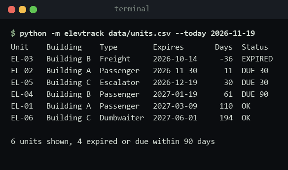

# elevator-inspection-tracker

[](https://github.com/yassine2med/elevator-inspection-tracker/actions/workflows/ci.yml)  

Lists elevator and escalator certificates soonest expiry first, banded by days left.



## What it is for

Elevators, escalators and lifts need a current inspection certificate, and an expired one can force a unit out of service. A building manager, facility coordinator or safety officer uses this tool to see which certificates lapse soon. It reads a CSV of units with their last inspection and certificate expiry dates and lists them soonest first, banded by how long is left, so renewals can be booked before the certificate lapses.

## Install

```
git clone <this repo> && cd elevator-inspection-tracker
python -m pip install -e .
python -m pytest -q
```

## How to use

| I want to | Command |
| --- | --- |
| List all units with their status, soonest expiry first | `python -m elevtrack data/units.csv` |
| Report as of a fixed date instead of today | `python -m elevtrack data/units.csv --today 2026-11-19` |
| Show only units expiring within a number of days | `python -m elevtrack data/units.csv --within 60` |
| See all options | `python -m elevtrack --help` |

Input columns: unit, building, type, last_inspection, certificate_expires (dates as YYYY-MM-DD). Exit code is 2 when any shown unit is expired, 1 on input errors, 0 otherwise, so it can run in a scheduled job.

Worked example:

```
python -m elevtrack data/units.csv --today 2026-11-19
```

Output:

```
Unit    Building    Type        Expires       Days  Status
EL-03   Building B  Freight     2026-10-14     -36  EXPIRED
EL-02   Building A  Passenger   2026-11-30      11  DUE 30
EL-05   Building C  Escalator   2026-12-19      30  DUE 30
EL-04   Building B  Passenger   2027-01-19      61  DUE 90
EL-01   Building A  Passenger   2027-03-09     110  OK
EL-06   Building C  Dumbwaiter  2027-06-01     194  OK

6 units shown, 4 expired or due within 90 days
```

## How it works

- Days left = expiry date minus the report date.
- Bands: negative is EXPIRED, 0 to 30 is DUE 30, 31 to 60 is DUE 60, 61 to 90 is DUE 90, above 90 is OK.
- Units are sorted by days left, then unit name.
- The file is rejected for missing columns, bad dates, duplicate unit names, or an expiry date earlier than the last inspection.

## Limits

- It tracks one certificate date per unit. Category 1, 3 and 5 test schedules, code violations and repair tickets are not modeled.
- No reminders are sent. Use the exit code or output in your own scheduler.
- The sample data is invented.

## License

MIT. Yassine Emhamed, 2026.
